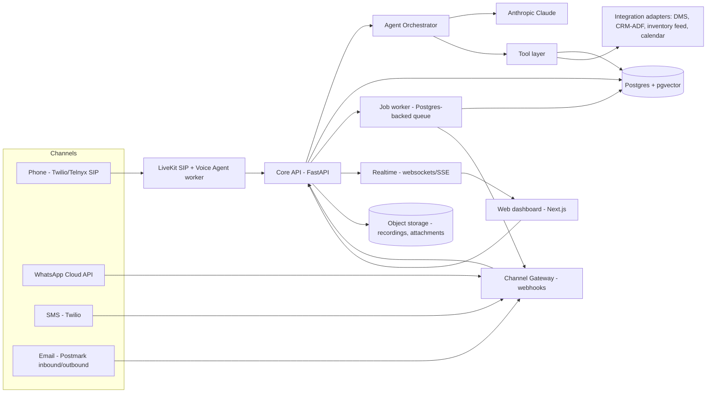

# Ondra — Architecture & System Design Build Plan

> **How to use this file:** it lives at the root of this repo. Tell Claude Code:
> *"Read BUILD_PLAN.md fully. Build the system it describes, one build step at a time, in order. Stop at the end of each step, run the tests, and show me what you built against that step's acceptance criteria before moving on."*

---

## 0. Instructions for Claude (read first)

You are the lead engineer building **Ondra** (working name), a multi-tenant AI platform for car dealerships. Follow these rules for the whole project:

1. **Work in the build order in §12.** Finish one step, make its acceptance criteria pass, then stop and summarise. Do not start the next step until I say so.
2. **Never invent third-party API details.** For WhatsApp Cloud API, Twilio, Telnyx, LiveKit, Postmark, Anthropic and any DMS, read the current official docs before writing integration code. If you can't verify something, write it behind an interface with a mock and leave a `TODO(verify)` comment.
3. **Every external service has a mock.** The whole system must run locally with `docker compose up` and no real accounts, using mock adapters and seed data.
4. **Keep a decision log.** Append every non-obvious choice to `docs/DECISIONS.md` (date, decision, why, alternatives).
5. **Tests are part of done.** Unit tests for domain logic, integration tests for each adapter (against mocks), and conversation evals for the AI agent (§9).
6. **Secrets never touch git.** Use `.env` files (gitignored) and an `.env.example` with every variable documented.
7. **Ask before adding infrastructure** that isn't in this plan (new databases, queues, paid services).
8. **Tenant isolation is non-negotiable.** Every table that holds dealer data has `tenant_id`, and every query is tenant-scoped (§10).

---

## 1. Product summary

Ondra answers every customer conversation a dealership gets — **phone calls, WhatsApp, SMS, email** (Instagram DMs later) — with an AI agent that:

- replies within seconds, 24/7, in the dealer's voice;
- qualifies buyers (vehicle, budget, destination, timeline, payment method);
- answers questions from the dealer's own knowledge base and live inventory;
- **books showroom visits, test drives and service appointments**;
- routes anything it shouldn't handle to the right human with a short brief;
- runs follow-ups so leads don't go cold;
- syncs with the dealer's **DMS/CRM** where one exists, and acts as a lightweight CRM where it doesn't.

Humans work in a **web dashboard** (inbox, clients, deals, tasks, calendar, analytics, settings). The owner can also run their day from **WhatsApp** (morning briefing, voice notes, one-tap approvals).

**Target customers:** US independent and franchised dealers, with a strong fit for dealers whose buyers use WhatsApp (exporters, immigrant-community dealers).

**Non-goals (do not build):** payments, invoicing, F&I/desking, accounting, the dealer's public website, vehicle shipping logistics.

---

## 2. Users & roles

| Role | What they do in Ondra | Main surfaces |
|---|---|---|
| Owner / GM | Sees everything; VIP alerts; approves drafts; sets rules | Web dashboard, WhatsApp briefing |
| Sales / BDC | Works sales leads, test drives, follow-ups | Inbox, Deals, Tasks, Calendar |
| Service advisor | Works service bookings and repair-order questions | Inbox, Calendar, Tasks |
| Logistics / ops | Shipping and paperwork questions | Inbox, Tasks |
| Admin | Users, integrations, billing, compliance settings | Settings |
| AI agent | Talks to customers within policy; calls tools | Runs in background |
| Customer | Never logs in; talks via phone, WhatsApp, SMS, email | External channels |

RBAC: `owner`, `admin`, `manager`, `sales`, `service`, `ops`, `viewer`. Permissions are per-resource (e.g. VIP contacts visible to owner/manager only unless granted).

---

## 3. High-level architecture



### Services (monorepo)

| Service | Tech | Responsibility |
|---|---|---|
| `apps/api` | Python 3.12, FastAPI, SQLAlchemy 2 (async), Alembic, Pydantic v2 | Domain logic, REST API, channel webhooks, auth, routing engine, agent orchestrator for text channels |
| `apps/voice` | Python, LiveKit Agents, LiveKit SIP | Real-time voice agent; shares the tool layer with `api` via a shared package |
| `apps/worker` | Python, Postgres-backed job queue (e.g. `procrastinate`) | Follow-up timers, briefings, inventory sync, ADF pushes, retries, analytics rollups |
| `apps/web` | Next.js (App Router), TypeScript, Tailwind, TanStack Query | Dashboard: inbox, clients, deals, tasks, calendar, analytics, settings |
| `packages/core` | Python shared lib | Models, tool definitions, policies, channel adapter interfaces |
| `infra/` | Docker Compose (dev), Terraform later | Postgres, object storage (MinIO in dev), LiveKit (cloud or self-hosted) |

**Decision:** build our own inbox in `apps/web` instead of using Chatwoot. Reason: one source of truth in our Postgres, one UI, our branding, no second stack (Rails) to operate. Record this in `docs/DECISIONS.md`.

**Decision:** Postgres is the only datastore at the start (relational data, vectors via pgvector, job queue). Add Redis only if a measured need appears.

---

## 4. Core flows

### 4.1 Inbound text message (WhatsApp / SMS / email)

```mermaid
sequenceDiagram
  participant C as Customer
  participant GW as Channel Gateway
  participant API as Core API
  participant P as Policy engine
  participant A as Agent
  participant H as Human (web)
  C->>GW: message
  GW->>API: normalized InboundMessage (idempotent by provider msg id)
  API->>API: resolve contact (phone/email/wa_id) or create
  API->>P: evaluate (VIP? opted out? AI enabled for channel? business rules)
  alt VIP or AI disabled
    P->>H: alert + task (no AI reply)
  else AI allowed
    API->>A: run agent with conversation context + tools
    A->>A: answer / call tools / extract lead fields
    alt needs human (policy, low confidence, explicit ask)
      A->>H: handoff task with brief; tell customer who will reply
    else
      A->>GW: send reply (or save as draft if draft-mode)
    end
  end
  API->>API: log everything, update lead, start follow-up timer
```

### 4.2 Inbound phone call

1. Call hits Twilio/Telnyx number → SIP trunk → LiveKit room → `apps/voice` agent joins.
2. **Before greeting**, look up caller ID → inject contact context (open deal, open repair order, last appointment, VIP flag).
3. VIP → the AI does **not** speak. Immediately ring the owner's (or the VIP's assigned handler's) phone and bridge the call so the caller just hears ringing. If unanswered after a configurable number of rings, play a short message ("Mr. Jay will call you back shortly"), send the owner an instant WhatsApp alert (who, what about, last purchase) and create a high-priority task. Support a second setup where the owner's personal cell forwards to Ondra **only on no-answer/busy**, so VIPs reach him directly and the AI only catches missed calls.
4. Otherwise run the voice agent with the same tool layer as text, using a **router/supervisor pattern** (sales, service, general) so callers can switch intent mid-call.
5. Warm transfer (SIP REFER or LiveKit transfer) to a human when policy requires, briefing the human first.
6. After the call: store recording (if consent obtained), transcript, AI summary, sentiment flag, extracted fields; create tasks; push ADF lead if applicable.
7. **Missed/abandoned calls** (if AI voice disabled for a tenant or outage): automatic SMS/WhatsApp text-back within 60s.

### 4.3 Booking (showroom visit, test drive, service)

- Bookable services are **appointment types configured by each dealer** (see `appointment_types` in §5): name, category (showroom, test_drive, service, appraisal, delivery, custom), duration, buffer, eligible staff roles/users, required resources (e.g. service bay, loaner car), capacity, bookable hours, minimum notice, maximum days ahead, info the AI must collect before booking, reminder schedule. Ship templates (showroom visit, test drive, oil change, inspection, trade-in appraisal, vehicle delivery) that dealers adjust.
- **One calendar must be the source of truth per dealer** to prevent double-booking: Ondra's internal calendar for dealers with no system; otherwise the external calendar/DMS is authoritative and Ondra reads availability from it and writes bookings into it.
- Availability comes from an `AvailabilityProvider` interface: **internal calendar** (default), **Google/Microsoft calendar**, or **DMS scheduler adapter** (e.g. service scheduling) when connected.
- Showroom/test drive: slot + assigned salesperson (round-robin or rules) + vehicle stock number held.
- Service: vehicle (VIN/year/make/model), service type, slot, advisor, transport need (loaner/shuttle/wait).
- Confirmation + reminders (24h and 2h before) on the customer's channel; reschedule/cancel via reply.

### 4.4 Owner on WhatsApp

- **Morning briefing** at a tenant-configured local time: VIPs waiting, hot leads, drafts to approve, overdue tasks, today's appointments. Sent as an approved WhatsApp template (business-initiated messages outside the 24h window require templates).
- **Voice notes / free text** from the owner to the Ondra assistant number: transcribe → identify client(s) → update profile/deal → create tasks → confirm back.
- **One-tap approvals** of drafted follow-ups via interactive buttons.

### 4.5 How dealers connect their channels (customers keep using the dealer's existing contact details)

Customers never see a new number or address. Ondra sits behind the dealer's existing lines:

- **Calls:** the dealer keeps their number and turns on call forwarding at their carrier to a Ondra-provisioned number — either *always* (AI answers everything) or *on no-answer/busy* (AI as backup). Number porting into Ondra is optional for dealers who want it. Provide carrier-specific forwarding instructions in onboarding.
- **WhatsApp:** connect the dealer's existing WhatsApp Business number via the official Cloud API using Meta's Embedded Signup flow; use coexistence where available so staff can keep the WhatsApp Business app. A personal WhatsApp account must be converted to WhatsApp Business first.
- **SMS:** via the ported number, or a Ondra number used for texting with the dealer's branding.
- **Email:** dealer forwards sales@/service@ to a Ondra inbound address, **or** connects Gmail/Microsoft 365 via OAuth so replies send from their real mailbox.
- **New numbers** are only for dealers without a business line, per-campaign call tracking, or a test line before go-live.

---

## 5. Data model (Postgres)

All tables: `id uuid pk`, `tenant_id uuid not null` (except `tenants`), `created_at`, `updated_at`. Use Row-Level Security keyed on `tenant_id`.

| Table | Key fields |
|---|---|
| `tenants` | name, timezone(s), locale, business hours, plan, settings jsonb |
| `users` | email, name, role, phone, notification prefs, active |
| `contacts` | display_name, is_vip, vip_owner_user_id, preferred_channel, language, tags[], notes, merged_into_id |
| `contact_identities` | contact_id, kind (phone, whatsapp, email, instagram), value (normalized E.164 / lowercased email), verified |
| `contact_relations` | contact_id, related_contact_id, relation (assistant, manager, spouse) |
| `consents` | contact_id, channel, purpose (transactional, marketing), status (opted_in/out), source, captured_at, evidence |
| `conversations` | contact_id, channel, status (open, waiting_customer, waiting_staff, closed), assigned_user_id, ai_mode (auto, draft, off), last_inbound_at (for 24h window) |
| `messages` | conversation_id, direction, author_type (customer, ai, user, system), author_user_id, body, attachments jsonb, provider, provider_message_id (unique), status (queued, sent, delivered, read, failed), is_draft |
| `calls` | conversation_id, provider_call_sid, direction, started_at, duration_s, recording_url, recording_consent, transcript jsonb, summary, sentiment, outcome |
| `deals` | contact_id, type (sales, service), stage, vehicle_of_interest jsonb, budget_min/max, currency, destination, timeline, payment_method, owner_user_id, source_channel, value_estimate, lost_reason |
| `vehicles` | stock_number, vin, year, make, model, trim, price, mileage, status (available, hold, sold), photos[], source_feed, raw jsonb |
| `appointment_types` | name, category, duration_min, buffer_min, eligible_roles[], eligible_user_ids[], required_resource_kinds[], capacity, bookable_hours jsonb, min_notice_min, max_days_ahead, required_fields jsonb, reminder_schedule jsonb, active |
| `resources` | kind (service_bay, loaner, demo_vehicle, room), name, capacity, hours jsonb, active |
| `appointments` | contact_id, deal_id, appointment_type_id, starts_at, ends_at, assigned_user_id, resource_ids[], vehicle_id/vin, service_type, transport, status (booked, confirmed, showed, no_show, cancelled), source (ai, staff, customer_link), external_ref |
| `tasks` | title, contact_id, deal_id, conversation_id, assignee_user_id, due_at, status, source (ai_handoff, rule, manual), brief, escalated_at |
| `routing_rules` | priority, conditions jsonb (topic, channel, VIP, hours, language, deal type), action jsonb (assign role/user, ai_mode, alert), active |
| `knowledge_docs` | title, body, category, embedding vector, updated_by |
| `knowledge_gaps` | question (normalized), example_conversation_ids[], occurrences, status (open, answered, ignored), answer_doc_id — filled whenever the AI hands off because it didn't know |
| `policies` | never_say[], price_disclosure (none, listed, range), handoff_triggers[], draft_mode bool, quiet_hours |
| `message_templates` | channel, provider_template_name, language, category, body, variables, approval_status |
| `follow_up_sequences` | name, steps jsonb (delay, channel, template/draft, require_approval) |
| `integrations` | kind (dms, crm_adf, inventory_feed, calendar, whatsapp, twilio, email), config jsonb, credentials (encrypted), status, last_sync_at |
| `events` | type, payload jsonb, occurred_at (for analytics + audit trail of business events) |
| `audit_log` | actor (user/ai/system), action, resource, before/after, ip |

---

## 6. Agent design

### 6.1 Orchestrator

- One orchestrator per turn: builds context → runs the LLM with tools → applies output policy → sends or drafts.
- **Context:** tenant profile + policies, contact profile + open deals/appointments, last N messages (summarise older), relevant knowledge chunks (pgvector), channel constraints (SMS length, WhatsApp template window).
- **Models:** `claude-sonnet-5-5` for conversations and tool use; `claude-haiku-5-5` for classification, extraction and summaries. Put model names in config.
- **Structured outputs** for extraction (lead fields, intent, sentiment, handoff reason) validated with Pydantic.
- **Language:** reply in the customer's language; handle English with Nigerian, Ghanaian and Hispanic accents in voice; support Spanish in v1 of the voice agent if the tenant enables it.

### 6.2 Tools (shared by text and voice)

| Tool | Purpose |
|---|---|
| `get_contact_context()` | Profile, open deals, appointments, VIP flag |
| `update_lead_fields(fields)` | Write extracted vehicle/budget/destination/timeline |
| `search_inventory(filters)` | Live stock with price policy applied |
| `get_vehicle(stock_or_vin)` | Details + photos link |
| `check_availability(kind, date_range, constraints)` | Showroom/test drive/service slots |
| `book_appointment(kind, slot, details)` | Creates appointment + confirmation |
| `reschedule_or_cancel(appointment_id, …)` | |
| `get_repair_order_status(ro_or_phone)` | Via DMS adapter (mock until connected) |
| `get_shipment_status(order_ref)` | Via adapter (stub; dealer-specific) |
| `search_knowledge(query)` | FAQs, policies, process |
| `handoff(reason, brief, urgency, target_role)` | Creates task, assigns, tells customer who/when |
| `push_crm_lead(deal_id)` | ADF/XML to dealer CRM |
| `schedule_follow_up(sequence, start_at)` | |

### 6.3 Policy layer (runs before and after the LLM)

- **Pre:** VIP → no AI; opted-out → no outbound; `ai_mode=off` → no AI; outside quiet hours for outbound → defer.
- **Post:** block `never_say` topics; block price/discount commitments unless policy allows; block promises of dates; confidence or "I'm not sure" → handoff; profanity/anger → handoff + manager alert.
- **Draft mode:** AI writes, human approves (default for a tenant's first week).
- Every AI action is logged with inputs/outputs (PII redacted in logs) for audit and evals.

### 6.3a Learning loop

- In draft mode, store each staff edit of an AI draft (before/after) and surface patterns to the dealer as suggested knowledge-base additions.
- Every "I don't know" handoff creates or increments a `knowledge_gaps` row. The dashboard shows an **Unanswered questions** list; when the dealer writes an answer once, it becomes a knowledge doc and the AI uses it from then on.
- Staff can rate any AI reply (good / wrong / tone) from the inbox; ratings feed the eval set.

### 6.4 Voice specifics

- LiveKit Agents with streaming STT (e.g. Deepgram), streaming TTS (e.g. Cartesia or ElevenLabs), interruption handling, endpointing tuned for phone audio.
- Target: < 1s response latency on average; graceful "one moment" fillers while tools run.
- Recording disclosure at call start where required by the tenant's state settings; no recording without consent.

---

## 7. Routing engine

Evaluate `routing_rules` by priority on every inbound message/call and on every AI handoff:

1. VIP → owner (or configured VIP handler), alert immediately, re-alert after N minutes.
2. Topic (classified by Haiku): sales, service, shipping/logistics, finance question, complaint, other → role/user.
3. Business hours per tenant timezone (support multiple timezones, e.g. Dallas + Lagos staff) → on-shift users only; else queue for next shift and tell the customer.
4. Load balancing: round-robin among eligible users, skip those at capacity.
5. SLA timers per task; breach → escalate to manager/owner.

Rules are editable in the dashboard (Settings → Routing) as structured forms, not code.

---

## 8. Integrations

| Integration | Approach | Notes |
|---|---|---|
| WhatsApp | Meta WhatsApp Cloud API (official) via Embedded Signup | Business verification, templates for business-initiated messages, 24h service window, coexistence so the owner can keep the WhatsApp Business app — verify availability per number. Offering Embedded Signup to dealers requires Ondra to be approved as a Meta Tech Provider — until then, connect pilot dealers manually |
| Phone | Twilio or Telnyx numbers → SIP trunk → LiveKit | Number porting/forwarding guide for dealers |
| SMS | Twilio Messaging | A2P 10DLC brand/campaign registration required before production |
| Email | Postmark (inbound webhook + outbound) **or** Gmail / Microsoft 365 via OAuth | Forwarding option: per-tenant inbound address + sending domain with SPF/DKIM. OAuth option: read and send from the dealer's real mailbox |
| Dealer CRM | ADF/XML lead emails (industry standard) | Works with most dealer CRMs without partner approval |
| Inventory | CSV/XML feed import (scheduled) + manual CSV upload | Map common feed formats; dedupe by VIN |
| DMS | `DmsAdapter` interface: `get_customer`, `get_repair_order`, `get_service_slots`, `book_service` | Ship `MockDms` + `CsvDms` first; real vendor adapters (CDK, Reynolds, Tekion, DealerCenter, etc.) require partner programs — build each behind the interface when access is granted |
| Calendar | Internal calendar default; Google/Microsoft optional | |
| Instagram DMs | Later; needs Meta app review | Same channel adapter interface |

**Channel adapter interface** (in `packages/core`): `parse_webhook(request) -> list[InboundEvent]`, `send(message) -> ProviderResult`, `verify_signature(request)`, `supports(feature)`. Each adapter has a mock.

---

## 9. Quality: evals & testing

- **Golden conversations:** at least 50 scripted scenarios in `evals/` (new buyer, export buyer asking about shipping, price haggling, service booking, angry customer, VIP, opted-out contact, Spanish speaker, intent switch mid-call). Each asserts: correct tools called, policy respected, fields extracted, handoff when expected.
- Run evals in CI on every change to prompts, tools or policies; track pass rate over time.
- Integration tests against mock adapters for every channel and DMS.
- Load test: 50 concurrent conversations per tenant without dropped messages.
- Voice: recorded test calls with varied accents and background noise; measure latency and word error rate.

---

## 10. Security & compliance

- **Tenant isolation:** `tenant_id` on every row + Postgres RLS; tests that prove cross-tenant reads fail.
- **Auth:** email + password with MFA, or SSO later; short-lived JWT access tokens; RBAC enforced server-side.
- **Encryption:** TLS everywhere; integration credentials encrypted with a KMS-managed key; recordings in private object storage with signed URLs.
- **FTC Safeguards Rule:** many dealers are covered and must oversee their service providers. Maintain a written information security program, vendor list, incident response plan, access reviews and audit logs so dealers can pass due diligence.
- **TCPA / consent:** record consent per contact and channel; honour STOP/opt-out instantly across channels; quiet hours for outbound; no automated outbound calls/texts without the right consent. Get legal review before enabling outbound campaigns.
- **Call recording:** configurable disclosure; respect all-party-consent states.
- **WhatsApp policy:** templates for business-initiated messages; respect the 24h window; opt-in records.
- **Data retention:** per-tenant retention settings; delete/export a contact's data on request.
- **LLM data handling:** redact PII from logs; no training on customer data; document subprocessors.

---

## 11. Web dashboard (apps/web)

Screens (all role-aware, responsive to phone width):

1. **Home / revenue dashboard:** deals in play sourced by AI, leads captured after hours, median first response, follow-ups sent, appointments booked/shown, pipeline by stage, leads by channel, AI vs human handling.
2. **Inbox:** unified conversations across channels; filters (mine, VIP, AI handling, waiting staff); thread view with calls inline (transcript + recording); AI brief panel; suggested reply with approve/edit; take over/hand back to AI; assign.
3. **Clients:** list + profile (identities, preferences, relations, timeline across channels and calls, deals, appointments, consents).
4. **Deals:** kanban by stage (sales and service pipelines).
5. **Tasks:** board by status/owner with SLA badges.
6. **Calendar:** showroom, test drive and service appointments by user/bay; drag to reschedule.
7. **Inventory:** synced vehicles, holds, feed status.
8. **Settings:** business profile & hours, users & roles, routing rules, AI policies & draft mode, knowledge base, templates, follow-up sequences, channels & numbers, integrations (DMS, CRM ADF, inventory, calendar), compliance (consent, recording, retention).
9. **Live call view:** active calls with live transcript and "barge/transfer" controls.

Realtime updates via websockets or SSE.

---

## 12. Build order (all features are in scope; this is sequence, not versions)

Each step ends with tests passing and a demo against its acceptance criteria.

**Step 1 — Foundations**
Monorepo, Docker Compose (Postgres + pgvector, MinIO), FastAPI skeleton, Alembic migrations for §5, auth + RBAC, tenant isolation with RLS, Next.js shell with login and navigation, seed script (1 tenant, 5 users, 50 vehicles, 30 contacts).
*Accept:* `docker compose up` works; cross-tenant access tests fail as expected; seeded data visible in web.

**Step 2 — Channel gateway + text agent**
Adapter interface; mock adapters; WhatsApp Cloud API + Twilio SMS + Postmark email adapters (behind feature flags); idempotent webhook ingestion; contact resolution; orchestrator with tools `get_contact_context`, `search_inventory`, `search_knowledge`, `update_lead_fields`, `handoff`; policy layer incl. VIP and draft mode.
*Accept:* a mock WhatsApp message gets a correct AI reply in < 5s; VIP gets no AI reply and creates an alert; draft mode stores a draft; 20 golden conversations pass.

**Step 3 — Inbox, clients, tasks**
Inbox UI with realtime, AI brief panel, approve/edit drafts, take over; client profile with timeline; tasks board with SLA timers and escalation via worker.
*Accept:* a staff user can work a lead end-to-end in the UI; an overdue task escalates.

**Step 4 — Booking**
Appointment types + resources (with templates) and their settings UI, internal calendar, availability provider interface, booking tools, confirmations and reminders, reschedule/cancel via reply, calendar UI, no-show tracking.
*Accept:* a dealer creates a custom appointment type in settings; AI books a test drive and a service appointment (with a bay) from a WhatsApp chat without double-booking; reminders fire; staff see them in the calendar.

**Step 5 — Voice**
Twilio/Telnyx → LiveKit SIP; voice agent with caller lookup, router pattern, shared tools, warm transfer, missed-call text-back, post-call summary + transcript into the inbox; recording with consent.
*Accept:* a real test call books an appointment; a "talk to a manager" request warm-transfers; average response latency measured and logged.

**Step 6 — Routing engine, follow-ups & learning loop**
Rules UI, topic classification, business hours per timezone, round-robin, follow-up sequences with approval, opt-out handling across channels, quiet hours, knowledge gaps ("Unanswered questions") list and answer flow, staff ratings on AI replies.
*Accept:* rules route test messages correctly across 10 scenarios; STOP on SMS blocks all outbound to that contact; an unanswered question answered by the dealer is used by the AI on the next identical question.

**Step 7 — Integrations**
ADF/XML lead push; inventory feed import; `DmsAdapter` with `MockDms` and `CsvDms`; repair-order status tool; integration settings UI with health status.
*Accept:* a qualified lead produces a valid ADF/XML email; inventory CSV import updates stock; RO status answered from mock DMS.

**Step 8 — Owner WhatsApp layer**
Morning briefing (template), owner voice notes → transcription → updates/tasks, interactive approval buttons, natural-language questions ("who wanted a G63?").
*Accept:* briefing arrives at the configured local time with correct counts; a voice note updates the right client and creates a task.

**Step 9 — Analytics dashboard**
Event pipeline + rollups; home dashboard metrics from §11; per-channel and AI-vs-human breakdowns.
*Accept:* every metric on the dashboard is traceable to events; numbers match a hand-calculated test fixture.

**Step 10 — Hardening & compliance**
Audit log UI, retention jobs, data export/delete, security headers, rate limits, backups, monitoring (OpenTelemetry traces, error tracking), evals expanded to 50+ scenarios, load test, written security program docs in `docs/security/`.
*Accept:* all evals ≥ target pass rate; load test passes; restore-from-backup tested.

**Step 11 — Instagram DMs and self-serve onboarding**
Instagram adapter; self-serve onboarding wizard: sign up, add staff, WhatsApp Embedded Signup, carrier-specific call-forwarding guide with a live test call, email forwarding or Gmail/Microsoft OAuth, appointment types from templates, knowledge base starter questions, routing rules, VIP import, test conversation, go live in draft mode.
*Accept:* a new dealer can onboard themselves in under an hour with no help from us.

---

## 13. Repo layout

```
/apps
  /api        FastAPI app (routers, services, webhooks, orchestrator)
  /voice      LiveKit Agents worker
  /worker     background jobs
  /web        Next.js dashboard
/packages
  /core       shared models, tools, policies, adapter interfaces + mocks
/evals        golden conversations + runner
/infra        docker-compose, terraform (later)
/docs         DECISIONS.md, security/, runbooks/
BUILD_PLAN.md
.env.example
```

---

## 14. Configuration (.env.example must document)

`DATABASE_URL`, `ANTHROPIC_API_KEY`, `MODEL_CONVERSATION`, `MODEL_FAST`, `WHATSAPP_*` (app id, token, phone number id, verify token, app secret), `TWILIO_*`, `TELNYX_*`, `LIVEKIT_*`, `STT_*`, `TTS_*`, `POSTMARK_*`, `OBJECT_STORAGE_*`, `ENCRYPTION_KEY_ID`, `JWT_SECRET`, `APP_BASE_URL`, feature flags per channel.

---

## 15. Future modules — not in this build, but design so they fit

Keep module boundaries clean (separate routers/services per domain, events for cross-module triggers) so these can be added without rewrites:

- **Sales intelligence:** inventory matching to customer wishes, lead scoring, trade-in detection from service visits.
- **Service operations:** status updates driven by repair-order events, declined-service follow-ups (e.g. 7 and 30 days), technician video and inspection approvals, capacity-aware scheduling by technician skill, warranty paperwork help.
- **Retention campaigns:** recalls, maintenance reminders, reactivation, birthdays, trade-in timing (with consent checks).
- **Internal operations:** staff-to-staff messaging between departments with response-time tracking.
- **Export module:** shipment and customs status, document checklist per order, client portal with verified dealer contacts (anti-scam), multi-time-zone teams.
- **Insight:** call scoring and coaching, customer sentiment alerts, AI vs staff performance.
- **Pricing models:** support per-seat, per-location and pay-per-booked-appointment billing in the data model from the start (`events` must record who/what booked each appointment).

## 16. Before writing code (non-code tasks for the founders)

1. Confirm the product name (Ondra is the working name; check domain and trademark before launch).
2. Create accounts: Anthropic API, Twilio or Telnyx, LiveKit, Postmark, Meta Business Manager (start business verification and apply as a Meta Tech Provider early — these take time).
3. Register for SMS sending (A2P 10DLC) before any production texting.
4. Confirm the first pilot dealer and get their WhatsApp export, call volume and current tools.
5. Confirm employer outside-activity approvals for anyone on the team who needs them.

## 17. Open questions (do not guess — leave TODOs and ask)

1. Twilio or Telnyx as the primary telephony provider?
2. LiveKit Cloud or self-hosted LiveKit? *(Start on LiveKit Cloud: `docs/ARCHITECTURE.md`.)*
3. Which STT/TTS vendors after a latency and accent test?
4. Which DMS/CRM do the first pilot dealers actually use?
5. Hosting target (AWS, GCP, Fly, Render)? *(Decided 2026-11-25: Cloudflare plus managed Postgres plus a container host, see `docs/ARCHITECTURE.md`. Still open there: Fly.io or Render, Neon or Supabase.)*
6. Pricing/billing model (needed before Step 11).
