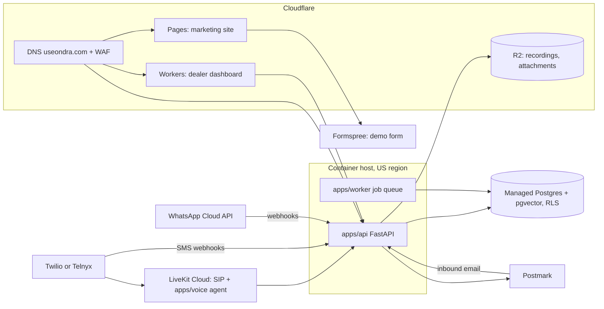

# Ondra hosting and deployment architecture

Where each part of Ondra runs in production, and why. The application design (services, data model, agent, channels) is in `BUILD_PLAN.md`; this file covers hosting. Decided on 2026-11-25 (see `docs/DECISIONS.md`). Vendor picks still open are marked **Open**.

## Summary

A hybrid setup with no servers of our own to start:

- **Cloudflare** handles the domain, the edge and anything static: DNS, the marketing site, the dashboard, and file storage.
- **A managed Postgres** holds all dealer data.
- **A container host** runs the Python services: the API and the job worker.
- **LiveKit Cloud** runs voice: SIP and the voice agent.

A VPS is not needed now. Revisit it when the monthly bill makes running our own servers worth the operations work.

## Where each part runs

| Part | Code | Runs on | Why |
|---|---|---|---|
| Marketing site | `apps/site` (static Next.js export) | Cloudflare Pages | It's a static build: free, fast and global. Deploys from the git branch. |
| DNS, TLS, firewall, bot protection | n/a | Cloudflare (DNS, WAF, Turnstile) | One place for the domain. Turnstile can protect public forms. |
| Dealer dashboard | `apps/web` (Next.js App Router) | Cloudflare Workers via the OpenNext adapter. **Open:** Vercel if the adapter fights us | Next.js server features need a runtime; Workers is workable, Vercel is the zero-friction fallback. `TODO(verify)` adapter support for the Next.js version we use. |
| Core API | `apps/api` (Python 3.12, FastAPI, async SQLAlchemy) | Container host, US region near Dallas. **Open:** Fly.io or Render | A long-running Python service with Postgres drivers that need native extensions. Cloudflare's Python Workers can't run this today. `TODO(verify)` whether Cloudflare Containers has matured enough to reconsider. |
| Job worker | `apps/worker` (Postgres-backed queue) | Same container host as the API | An always-on process: follow-up timers, briefings, inventory sync, retries. |
| Voice agent and SIP | `apps/voice` (LiveKit Agents, LiveKit SIP) | LiveKit Cloud (agent hosting and SIP) | Real-time audio needs persistent, low-latency servers. Answers BUILD_PLAN §17.2 for now: start on LiveKit Cloud, self-host only when volume justifies it. |
| Database | Postgres with pgvector, row-level security | Managed Postgres, US region. **Open:** Neon or Supabase now, AWS RDS later | Dealer data and RLS are the core of the product. Managed means backups, point-in-time restore and patching aren't on us. Cloudflare D1 is SQLite, with no RLS and no pgvector, so it is ruled out. |
| Object storage | Call recordings, attachments | Cloudflare R2 (S3-compatible; MinIO in local dev) | No egress fees, which matters for playing back recordings. Same S3 interface as MinIO, so the code doesn't change. |
| Product email | Transactional and inbound email | Postmark (as in BUILD_PLAN) | Unchanged. |
| Company mailbox | hello@useondra.com | Spaceship email | People write to us here; the site's contact address. |
| Demo form | `apps/site` "Book a demo" | Formspree, emailing hello@useondra.com | No backend needed for the marketing site. Moves to `apps/api` once it exists. |

## Regions and latency

Everything that sits on a live call or message path runs in a US region close to Dallas: the container host, Postgres and LiveKit. That's where the pilot dealer, the telephony providers and most buyers are. Cloudflare's parts are global by default.

## Environments

| Environment | How it runs |
|---|---|
| Local | `docker compose up`: Postgres, MinIO, and mocks for every external service, as BUILD_PLAN requires. No real accounts needed. |
| Staging | Same providers as production, with separate projects and databases. Test numbers, sandbox WhatsApp. |
| Production | As in the table above. |

## Secrets and configuration

- Secrets live in each provider's secret store: container host secrets, Cloudflare Workers secrets, LiveKit Cloud. Never in git.
- `.env.example` in each app lists every variable, documented.
- `NEXT_PUBLIC_*` values are public by design: the form endpoint, the contact email and the site URL.

## Backups and recovery

- Postgres: the managed provider's automated backups plus point-in-time restore. Test a restore before the first pilot goes live (BUILD_PLAN Step 10 acceptance: "restore-from-backup tested").
- R2: object versioning on the recordings bucket.

## When to revisit

- **A VPS** (for example Hetzner with Docker Compose): cheaper per month, but we would own backups, patching, uptime and security for customer data and call recordings. Consider it once monthly spend is significant and someone owns operations.
- **AWS or GCP:** if a dealer group or an OEM partnership requires specific compliance (SOC 2 scope, data residency), or once we need RDS-level Postgres.
- **Self-hosted LiveKit:** when call volume makes LiveKit Cloud's per-minute cost the largest line.

## Open choices

1. Container host: Fly.io or Render.
2. Managed Postgres: Neon or Supabase.
3. Dashboard host: Cloudflare Workers via OpenNext, or Vercel.
4. Telephony: Twilio or Telnyx (BUILD_PLAN §17.1, unchanged).
